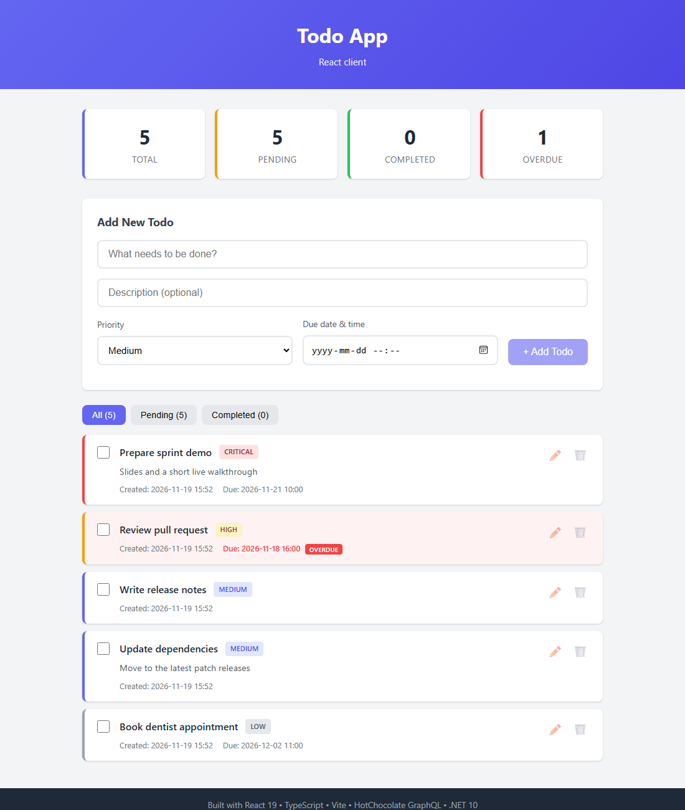
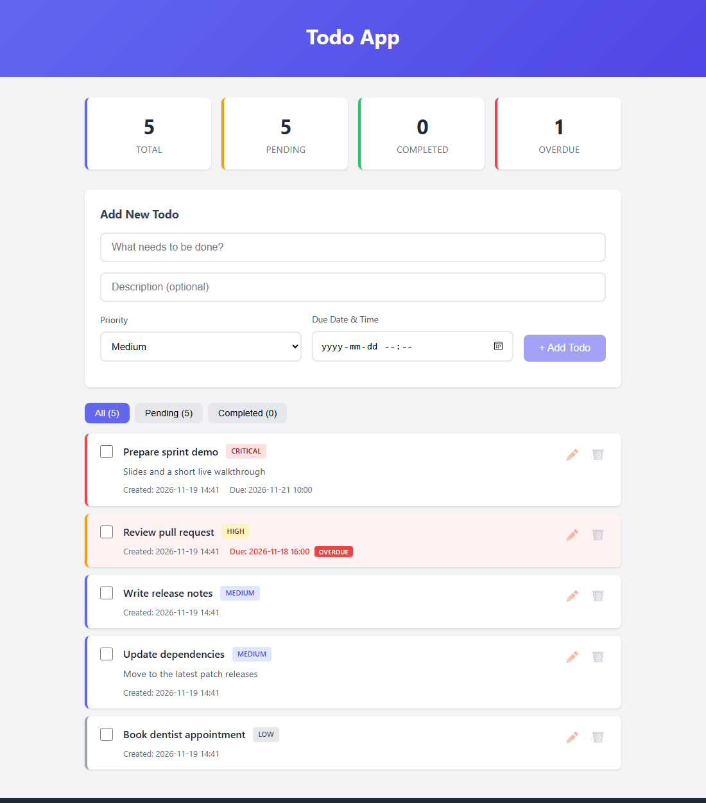
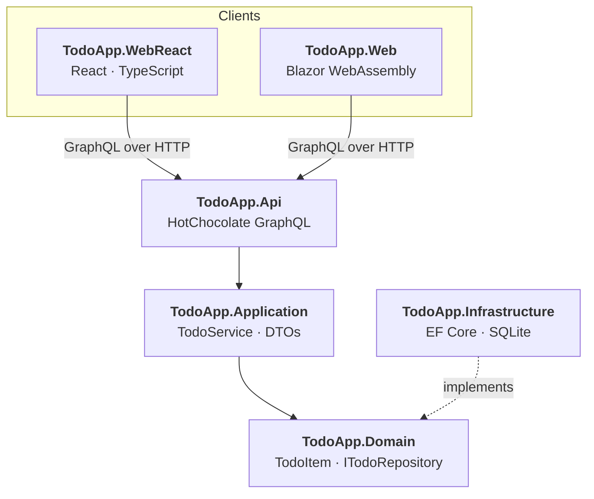

# Todo App: Clean Architecture with GraphQL

[](https://github.com/aabom/Todo-App/actions/workflows/ci.yml)

A todo application built as a small but complete example of **Clean Architecture** in .NET 10,
with a **headless GraphQL API** and **two independent front ends** on top of it:

- **TodoApp.Api:** a GraphQL API (HotChocolate) that stores todos in SQLite through EF Core.
- **TodoApp.WebReact:** a **React 19 + TypeScript** client built with Vite.
- **TodoApp.Web:** a **Blazor WebAssembly** client written in C#.

Both clients offer the same features and the same UI, and talk to the API only through GraphQL.
That is the point of the headless setup: the API knows nothing about who is calling it, so a
client can be added or replaced without touching the backend.

| React client | Blazor client |
|--------------|---------------|
|  |  |

## What it does

- Create, edit, complete and delete todos, each with a title, an optional description, a priority
  and an optional due date and time.
- The list is sorted by priority, then by the earliest due date (todos without one go last), then
  by the newest first.
- Todos past their due date are flagged as overdue. The header shows totals for all, pending,
  completed and overdue.
- The list can be filtered to all, pending or completed todos.

## Running it

**Prerequisites:**
- The [.NET 10 SDK](https://dotnet.microsoft.com/download), pinned in `global.json`.
- [Node.js 24](https://nodejs.org/) for the React client, pinned in `src/TodoApp.WebReact/.nvmrc`.

Start the API first; either client (or both at once) can then run against it.

```bash
# The API, at http://localhost:5000/graphql
cd src/TodoApp.Api
dotnet run
```

```bash
# The React client, at http://localhost:5173
cd src/TodoApp.WebReact
npm install
npm run dev
```

```bash
# The Blazor client, at http://localhost:5001
cd src/TodoApp.Web
dotnet run
```

The API creates `todo.db` on first start. Opening `http://localhost:5000/graphql` in a browser
loads Nitro, HotChocolate's GraphQL IDE, where the schema can be explored and queried. The React
client calls `/graphql` on its own origin, and the Vite dev server forwards that to
`http://localhost:5000` (set `API_URL` to point it elsewhere).

### With Docker

The API and the React client also run as containers. Docker is the only prerequisite:

```bash
docker compose up --build
```

The app is then at `http://localhost:8080`, and the API with Nitro at `http://localhost:5000/graphql`.
The database lives on the `todo-data` volume, so todos survive a restart; a fresh volume opens with
a few sample todos. `docker compose down -v` deletes the volume and starts over.

- **API:** built with the .NET SDK, run on the *chiseled* ASP.NET image (the runtime and nothing
  else: no shell, no package manager, non-root user). About 260 MB, most of it the runtime.
- **React client:** built with Node, served as static files by `nginx-unprivileged` (non-root,
  about 80 MB). nginx also forwards `/graphql` to the API.

**Why the client proxies instead of calling the API directly.** The address of the API is only
known where the app is deployed, but a Vite build bakes its settings into the JavaScript. Having
nginx forward `/graphql` keeps the address out of the build: it is read from `API_UPSTREAM` when
the container starts, so the same image works anywhere. Browser and API also share one origin,
so there is no CORS to configure. For a static host that cannot proxy, `VITE_API_URL` can still
be set at build time (`docker build --build-arg VITE_API_URL=…`) to call an API elsewhere.

## Running the tests

```bash
dotnet test                 # API, domain, persistence and the Blazor client

cd src/TodoApp.WebReact
npm test                    # the React client
npm run lint                # ESLint, type-aware rules
npm run typecheck           # tsc in strict mode
```

| Area | What is tested | How |
|------|----------------|-----|
| Domain | Title and description rules, completion, overdue logic | xUnit |
| Infrastructure | Sort order, overdue queries, UTC round-trip of dates, demo seeding | xUnit, real SQLite in memory |
| Application | Partial updates, clearing fields, statistics against the clock | xUnit, `FakeTimeProvider` + SQLite |
| API | The GraphQL schema the server exposes, including error shape | HotChocolate request executor |
| Blazor client | Ordering after adding, what an edit sends, error reporting | bUnit |
| React client | The same behaviour as the Blazor tests, plus time zones and filtering | Vitest + React Testing Library |
| React GraphQL layer | Data, validation errors, HTTP failures | Vitest with a stubbed `fetch` |

CI runs three jobs on every pull request and every push to `main`:
- **.NET:** builds with warnings as errors, and fails on a package with a known vulnerability.
- **React:** runs `npm audit`, ESLint, `tsc`, Vitest and the production build.
- **Docker:** builds both images, starts them with Compose and creates and reads a todo through
  the nginx proxy.

## Architecture



Arrows point in the direction of dependency. Everything depends inward on the Domain, which
depends on nothing. Infrastructure implements the Domain's repository interface, so the
business logic never references EF Core. The Api project wires Infrastructure in through
dependency injection at startup.

```
src/
├── TodoApp.Domain/          Entity with its own rules, repository interface. No dependencies.
├── TodoApp.Application/     Use cases (TodoService) and DTOs.
├── TodoApp.Infrastructure/  EF Core DbContext and repository on SQLite.
├── TodoApp.Api/             GraphQL queries, mutations, types and error mapping.
├── TodoApp.WebReact/        React + TypeScript client.
│   └── src/
│       ├── api/             Typed GraphQL client and the TodoApi operations.
│       ├── hooks/           useTodos: the page's data and operations.
│       ├── components/      Presentational components.
│       └── lib/             Pure helpers: dates, filters, building an update.
└── TodoApp.Web/             Blazor WebAssembly client and its GraphQL client.
tests/
└── TodoApp.Tests/           .NET tests, one folder per layer. React tests sit next to their code.
```

## Design decisions

### API and domain

**A rich domain model.** `TodoItem` has private setters, and every change goes through a method.
The rules therefore live in one place and cannot be bypassed: a title is required and trimmed,
and the title and description have maximum lengths. A broken rule throws
`TodoValidationException`.

**Domain errors become readable GraphQL errors.** An error filter turns a
`TodoValidationException` into a GraphQL error carrying the rule's own message, the code
`VALIDATION_ERROR` and the offending field. Without the filter, the client would only ever see
"Unexpected Execution Error".

**Partial updates distinguish "unchanged" from "remove".** In `updateTodo`, a field that is left
out stays as it is. An empty `description` removes the description. A due date is removed with
`clearDueDate: true`. The flag is explicit because a missing `dueDate` and `dueDate: null` look
the same once they reach C#. Sending both a due date and `clearDueDate` is rejected.

**Time is injected.** The domain never reads the clock. `TodoService` gets the time from
`TimeProvider` and passes it in, so overdue logic is deterministic and the tests control the
clock.

**All times are UTC.** The clients convert local input to UTC before sending it and convert back
only for display. SQLite stores no time zone, so value converters in `TodoDbContext` mark dates
as UTC when they are read back. The UTC marker is what makes GraphQL serialize them with a `Z`
suffix.

**The server owns the sort order.** After adding or editing a todo, both clients reload the list
rather than guessing where the item belongs. The sort is applied in SQL. Items without a due date
are sorted last explicitly, because SQLite puts `NULL` first.

**SQLite and `EnsureCreated`.** The database is a single file, so the app runs with no setup.
Because this is a demo with one table and no deployed data to preserve, the schema is created
with `EnsureCreated` rather than migrations. A real deployment would switch to migrations.

**CORS lists the clients by origin.** `Cors:AllowedOrigins` in the API's `appsettings.json`
names the Blazor client (`localhost:5001`). Nothing else may call the API from another origin in
a browser. The React client needs no entry, because it reaches the API through a proxy on its own
origin (see [With Docker](#with-docker)).

### React client

**A small typed GraphQL client rather than Apollo or urql.** `createGraphQLClient` is a single
function: it POSTs one operation, returns `data` typed by the caller and throws on `errors`.
The app has six operations and no need for a normalised cache, because the server owns the sort
order and the list is reloaded after a change anyway. A full client would add weight without
solving a problem this app has. If the schema grew, the next step would be to generate the
TypeScript types from it with GraphQL Code Generator. Today they are written by hand in
`api/types.ts` and could drift from the schema.

**Validation errors keep their shape.** `GraphQLRequestError` holds every error the API returned
and exposes `isValidationError` and `invalidFields`. The `VALIDATION_ERROR` message, such as
"Title cannot be empty.", is what the user sees.

**One seam for tests.** Components never call `fetch`. They get a `TodoApi` interface through
`App`'s props. In the app that is the GraphQL implementation; in tests it is `FakeTodoApi`,
which sorts like the server and records what the UI sends. Tests therefore assert on the input
the API would receive, such as `clearDueDate: true`, rather than on implementation details.

**State lives in one hook.** `useTodos` holds the list, the statistics, loading and error state,
and the operations. Components stay presentational. One page does not need a global store.

**TypeScript as strict as it goes.** On top of `strict`, the project uses
`noUncheckedIndexedAccess` and `exactOptionalPropertyTypes`. ESLint runs typescript-eslint's
`strictTypeChecked` rules and the React Hooks rules. CI fails on any warning.

**Tests run in a fixed time zone.** Vitest runs in `Europe/Stockholm`, which is offset from UTC.
That proves dates are converted between UTC and local time, and the results are the same on a
developer machine and in CI.

**The same look as the Blazor client.** `src/index.css` is a copy of the Blazor client's
`app.css`, and both render the same markup classes, so the difference between them is the code,
not the look. Each client keeps its own copy so it can be built and deployed on its own. The
price is that a style change has to be made twice.

### Blazor client

**A hand-written GraphQL client here too.** `GraphQLService` sends the queries as plain strings
and deserialises `data`. It follows the same reasoning as the React client.

**It reuses the domain's `Priority` enum.** The Blazor project references the Domain project for
that single enum, so the two cannot drift apart. Nothing else crosses that boundary.

## Deliberately out of scope

These were left out on purpose, to keep the example focused on the architecture. A production
version would need them.

- **Authentication and per-user data.** Anyone who can reach the API can read and change every
  todo. The next step would be ASP.NET Core authentication, with an owner ID on `TodoItem`.
- **Pagination.** `todos` returns the whole list. HotChocolate's cursor paging (`[UsePaging]`)
  would be the natural addition once lists grow.
- **Migrations.** As described above, the schema is created with `EnsureCreated`.
- **Optimistic concurrency.** If two clients edit the same todo, the last write wins. A row
  version on `TodoItem` would detect the conflict.

## Example operations

```graphql
query {
  todos { id title priority dueDate isOverdue }
  statistics { totalCount completedCount pendingCount overdueCount }
}

mutation {
  createTodo(input: { title: "Learn GraphQL", priority: HIGH, dueDate: "2030-12-31T14:00:00Z" }) {
    id
  }
}

mutation($id: UUID!) {
  updateTodo(input: { id: $id, priority: CRITICAL, clearDueDate: true }) {
    id priority dueDate
  }
}

mutation($id: UUID!) {
  toggleTodoComplete(id: $id) { isCompleted completedAt }
}
```

## Tech stack

| Component | Technology |
|-----------|------------|
| Runtime | .NET 10, Node.js 24 |
| GraphQL server | HotChocolate 15 |
| ORM and database | EF Core 10, SQLite |
| React client | React 19, TypeScript 6 (strict), Vite 8 |
| Blazor client | Blazor WebAssembly |
| Tests | xUnit v3, bUnit, Vitest, React Testing Library |
| Quality | ESLint (typescript-eslint, strict type-checked), warnings as errors in .NET |
| Containers | Docker (chiseled .NET runtime, nginx-unprivileged), Docker Compose |
| CI | GitHub Actions |
